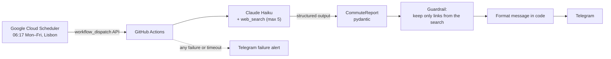

# Train Status Agent

Every weekday morning, an LLM agent searches the web for strikes and disruptions on my commute and sends the result to Telegram.

The commute is the Metro Sul do Tejo (MTS) from Corroios Casa do Povo to Corroios, then the Fertagus train from Corroios to Sete Rios, which I need to reach before 8:10.

## How it works



1. Google Cloud Scheduler triggers the workflow through the GitHub API. GitHub's own `schedule` trigger is best-effort and ran up to 6 hours late.
2. One call to `claude-haiku-5-5` with Anthropic's server-side `web_search` tool. The model returns a `CommuteReport` (pydantic) with a status for each line: `ok` or `problem`, a summary, advice, upcoming strike dates and a source URL.
3. The code, not the model, checks the report and builds the message.
4. The message goes to a single Telegram chat.

Example message:

```
🚇 MTS: ✅ Sem perturbações hoje
🚆 Fertagus: ⚠️ Greve parcial · 📅 Greve 16-18 nov
   ↳ Serviços mínimos de 50%
   🔗 https://www.fertagus.pt/...
```

## Design decisions

- **Structured output instead of free text.** The model fills a schema, and the code formats the message. The output format is checked by validation, not by the prompt, so changing the message can't break the guardrails.
- **No invented links.** A `source_url` is kept only if it was one of the search results. URLs inside the text fields are removed. This protects against hallucinated links and links injected through a search result.
- **Limited agency.** The model has only a read-only search tool. It can't send messages or take actions. My code decides what to send and where.
- **Loud on failure.** Any exception exits with a non-zero code. A workflow step then sends one Telegram alert with a link to the run. Because this happens at the workflow level, it also covers timeouts and crashes before the Python code runs.
- **Secrets stay out of logs.** Secret fields use `repr=False`, and the `httpx` loggers are set to `WARNING`, because the Telegram request URL contains the bot token.
- **Bounded cost and time.** The cheapest model that does the job, at most 5 searches, a 120 s API timeout, and an 8-minute step limit inside a 10-minute job.

## Running it

Requires [uv](https://docs.astral.sh/uv/) and Python 3.11.

```bash
# Create a .env with ANTHROPIC_API_KEY, TELEGRAM_BOT_TOKEN and TELEGRAM_CHAT_ID
uv run train-status-agent --dry-run   # print the message instead of sending it
uv run train-status-agent
```

`--dry-run` skips only Telegram. It still makes a real, paid Anthropic API call.

## Tests and CI

```bash
uv run pytest
uv run ruff check .
uv run mypy src
```

The tests fake the Anthropic client and Telegram, so they need no credentials. On every push and pull request, CI runs ruff, mypy, and pytest with branch coverage of at least 85%.

## Project layout

```
src/train_status_agent/
  agent.py     # prompt, web search call, link guardrail
  models.py    # CommuteReport schema and message formatting
  config.py    # settings from environment variables / .env
  telegram.py  # minimal Telegram Bot API client
  main.py      # CLI entry point
.github/workflows/
  commute.yml  # the daily run (workflow_dispatch) and the failure alert
  tests.yml    # CI
```

## Next steps

- An agent loop with a `get_timetable` tool, to estimate arrival times when there is a delay.

## License

[MIT](LICENSE)
